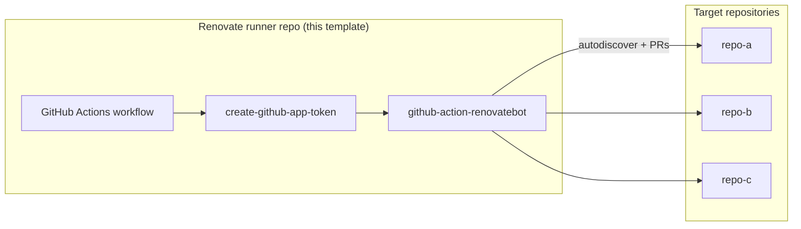

# Self-Hosted Renovate Runner for GitHub Actions

GitHub template for running a self-hosted [Renovate](https://docs.renovatebot.com/) bot on GitHub Actions. One runner repository manages dependency updates across many other repositories using a GitHub App.

This template ships with:

- A scheduled workflow that runs [WyriHaximus/github-action-renovatebot](https://github.com/WyriHaximus/github-action-renovatebot) (Composer plugins/scripts, post-upgrade `git add`, Docker socket access, and related defaults)
- A starter [`.github/renovate.json`](.github/renovate.json) extending the [`github-action` preset](https://github.com/WyriHaximus/renovate-config/blob/main/github-action.json) from [WyriHaximus/renovate-config](https://github.com/WyriHaximus/renovate-config)

For background on why this setup exists, see [Unlock Composer Plugins by Self Hosting Renovate](https://blog.wyrihaximus.net/2025/10/unlock-composer-plugins-by-self-hosting-renovate/).

## How it works



1. The workflow runs on a schedule (and on a few other triggers).
2. It mints a short-lived installation token for your Renovate GitHub App.
3. Renovate autodiscovers repositories the app can access and opens or updates dependency PRs.

The runner repository itself does not need to contain the code of the repositories Renovate manages.

## Prerequisites

- A GitHub user or organization account
- Permission to create a GitHub App and install it on the account(s) whose repositories you want Renovate to manage
- A dedicated repository created from this template (for example `my-org/renovate-runner`)

## Quick start

### 1. Create the runner repository

1. Click **Use this template** on GitHub (or create a new repository from this template).
2. Name it something clear, for example `renovate-runner` or `renovate-private-runner`.
3. Keep it **private** if Renovate should also manage private repositories.

### 2. Create a GitHub App

Create a new GitHub App under the same user or organization that will own the runner repository:

1. Go to **Settings → Developer settings → GitHub Apps → New GitHub App**.
2. Set a name (for example `My Renovate Bot`) and homepage.
3. Disable **Webhook → Active** (Renovate does not need webhooks for this setup).
4. Set **Repository permissions**:

   | Permission        | Access        | Why                                      |
   |-------------------|---------------|------------------------------------------|
   | Contents          | Read & write  | Read manifests, push update branches     |
   | Issues            | Read & write  | Dependency Dashboard                   |
   | Pull requests     | Read & write  | Open and update PRs                      |
   | Workflows         | Read & write  | Update GitHub Actions workflow files     |
   | Metadata          | Read          | Required baseline access                 |

5. Under **Where can this GitHub App be installed?**, choose **Only on this account** (recommended) or **Any account**, depending on your needs.
6. Create the app, then:
   - Note the **App ID** (used as `RENOVATE_BOT_CLIENT_ID`).
   - Generate and download a **private key** (used as `RENOVATE_BOT_PRIVATE_KEY`).
7. Install the app on your user or organization and grant it access to:
   - The runner repository itself, and
   - Every repository Renovate should manage (or **All repositories** if you prefer autodiscovery over the full installation).

### 3. Add repository secrets

In the **runner repository**, open **Settings → Secrets and variables → Actions** and add:

| Secret                     | Description |
|----------------------------|-------------|
| `RENOVATE_BOT_CLIENT_ID`   | GitHub App ID |
| `RENOVATE_BOT_PRIVATE_KEY` | Full contents of the downloaded `.pem` private key |
| `RENOVATE_REPOSITORIES`    | Comma- or newline-separated list of repositories Renovate may access in a single run (see below) |

#### `RENOVATE_REPOSITORIES`

This value is passed to [`actions/create-github-app-token`](https://github.com/actions/create-github-app-token) as the `repositories` input. It scopes the installation token Renovate uses.

Examples:

```text
my-org/renovate-runner,my-org/api,my-org/frontend
```

```text
my-org/renovate-runner
my-org/api
my-org/frontend
```

Include the runner repository in the list. Renovate autodiscovers from the repositories the token can access.

To manage **all** repositories in an installation, leave `RENOVATE_REPOSITORIES` empty and remove the `repositories` line from [`.github/workflows/renovate.yaml`](.github/workflows/renovate.yaml). The app token then covers the full installation (same as omitting `repositories` in the action).

### 4. Enable GitHub Actions

Ensure Actions are enabled on the runner repository. Push to `main` (or manually run the workflow) to verify the first run succeeds.

### 5. Onboard target repositories

For each repository Renovate should manage:

1. Grant the GitHub App access to that repository (during install, or later under **Settings → GitHub Apps**).
2. Add the repository name to `RENOVATE_REPOSITORIES` if you use scoped tokens.
3. Merge Renovate’s onboarding PR when it appears (or add your own `.github/renovate.json` first).

Renovate uses the onboarding config from [WyriHaximus/github-action-renovatebot](https://github.com/WyriHaximus/github-action-renovatebot) and writes config to `.github/renovate.json` unless you already provide one.

## Workflow behaviour

The default workflow in [`.github/workflows/renovate.yaml`](.github/workflows/renovate.yaml) runs Renovate when:

| Trigger | Purpose |
|---------|---------|
| Cron (weekdays, every 2 hours 06:00–22:00 UTC) | Regular dependency scans during waking hours |
| Cron (weekends, every 2 hours 12:00–23:00 UTC) | Lighter weekend schedule |
| Push to `main` | Pick up workflow or action updates immediately |
| Issue edited | Re-run when the Dependency Dashboard rebase checkbox is used |

Only one Renovate job runs at a time (`concurrency: renovate`, `cancel-in-progress: true`).

## Configuring Renovate

### Runner repository config

[`.github/renovate.json`](.github/renovate.json) in the runner repo mainly keeps Renovate’s own dependencies (the workflow and action pins) up to date:

```json
{
  "$schema": "https://docs.renovatebot.com/renovate-schema.json",
  "extends": [
    "github>WyriHaximus/renovate-config:github-action"
  ]
}
```

### Target repository config

Each managed repository should have its own `.github/renovate.json`. Common presets from [WyriHaximus/renovate-config](https://github.com/WyriHaximus/renovate-config):

| Preset | Use for |
|--------|---------|
| `github>WyriHaximus/renovate-config:php-package` | Public PHP libraries |
| `github>WyriHaximus/renovate-config:php-project` | Private PHP projects (limits PR volume) |
| `github>WyriHaximus/renovate-config:default` | General-purpose setup |

Example for a PHP application:

```json
{
  "$schema": "https://docs.renovatebot.com/renovate-schema.json",
  "extends": [
    "github>WyriHaximus/renovate-config:php-project"
  ]
}
```

See the [renovate-config README](https://github.com/WyriHaximus/renovate-config#usage) for all presets and package rules.

## Adding or removing repositories

1. **Install the app** on the new repository (or grant access in the app installation settings).
2. **Update `RENOVATE_REPOSITORIES`** in the runner repo secrets if you use scoped tokens.
3. Wait for the next scheduled run, push to `main`, or tick a checkbox on the Dependency Dashboard to trigger a run.

To stop managing a repository, revoke the app’s access to it and remove it from `RENOVATE_REPOSITORIES`.

## Optional: debug runs

For troubleshooting, add a manually triggered workflow or temporarily set `logLevel: debug` on the Renovate step:

```yaml
- name: Renovate
  uses: WyriHaximus/github-action-renovatebot@v0.16.0
  with:
    renovateAppToken: ${{ steps.app-token.outputs.token }}
    logLevel: debug
```

Debug logging uses JSON format and is verbose; switch back to `info` when finished.

## Optional: private registry credentials

If Renovate must authenticate to private registries (Docker Hub, Packagist, and so on), pass host rules into the action:

```yaml
- name: Renovate
  uses: WyriHaximus/github-action-renovatebot@v0.16.0
  with:
    renovateAppToken: ${{ steps.app-token.outputs.token }}
    hostRules: ${{ secrets.RENOVATE_HOST_RULES }}
```

Store `RENOVATE_HOST_RULES` as a JSON array, for example:

```json
[
  {
    "matchHost": "docker.io",
    "username": "my-user",
    "password": "my-token"
  }
]
```

## Related projects

| Repository | Role |
|------------|------|
| [WyriHaximus/github-action-renovatebot](https://github.com/WyriHaximus/github-action-renovatebot) | Composite action wrapping `renovatebot/github-action` with this setup’s defaults |
| [WyriHaximus/renovate-config](https://github.com/WyriHaximus/renovate-config) | Shared Renovate presets (scheduling, PHP rules, GitHub Actions pinning) |

## License

MIT © [Cees-Jan Kiewiet](https://wyrihaximus.net/) — see [LICENSE](LICENSE).
